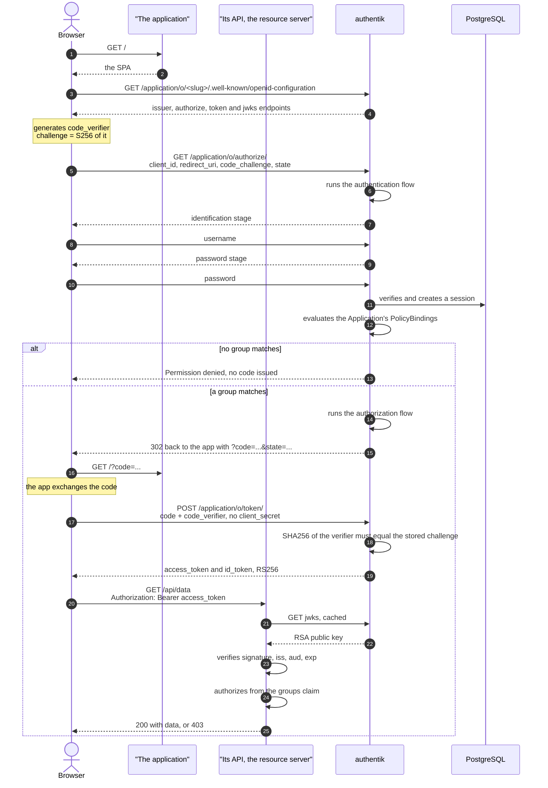
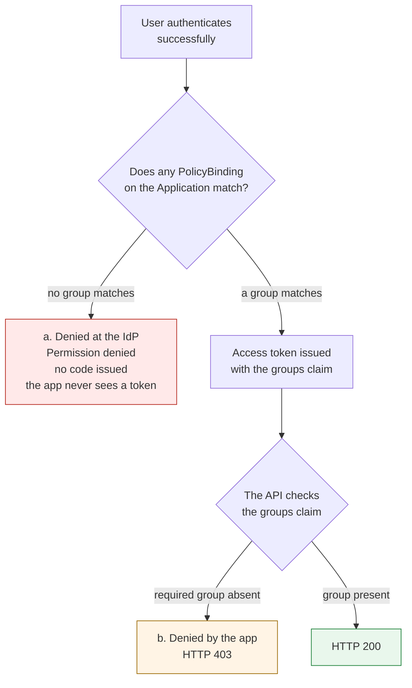
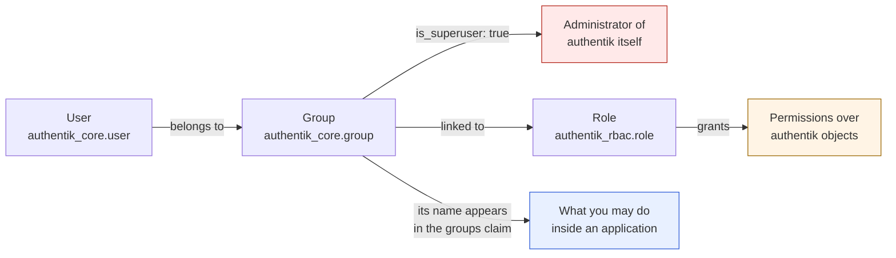
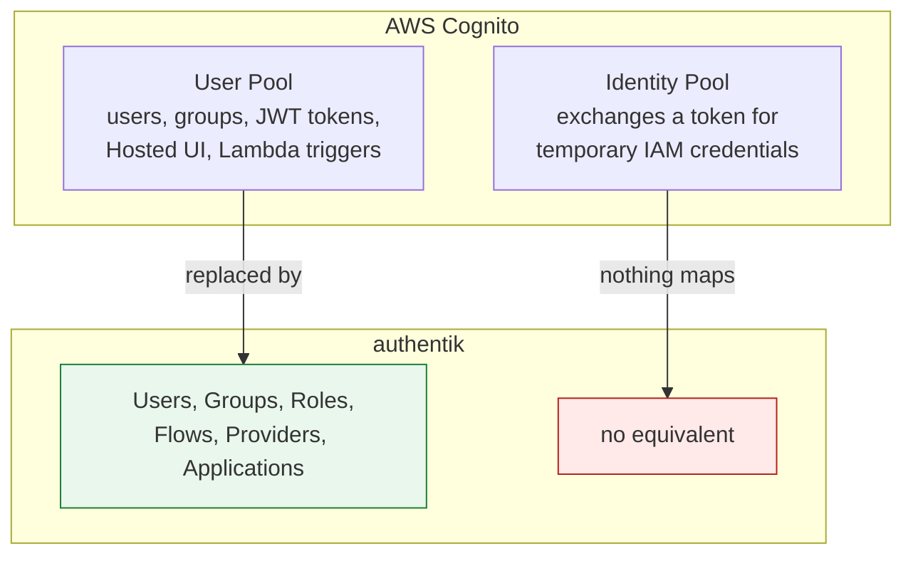

# authentik as the AWS Cognito replacement

How authentication and authorization work on authentik, what we proved in the proof of concept,
and what we found comparing it to AWS Cognito.

This document assumes you can read the upstream documentation. It does not repeat the
[authentik docs](https://docs.goauthentik.io/) or the
[Helm chart reference](https://artifacthub.io/packages/helm/goauthentik/authentik) — there is no
install walkthrough and no explanation of what an identity provider is. What it records is the
model, the integration points, and the traps that cost us time and are not written down clearly
anywhere else.

Verified against **authentik 2026.8.3**.

> **Status.** Proof of concept, verified on a local cluster, not production. Argo CD SSO is
> designed but **not implemented** — see §7.

## Wiki entries

| Required entry | Section |
|---|---|
| Authentication and authorization flows | [§2](#2-authentication-and-authorization-flows) |
| User and group management model | [§3](#3-user-and-group-management-model) |
| Argo CD integration | [§7](#7-argo-cd-integration) |
| High-level plan to deploy authentik to STACKIT | [§8](#8-deploying-authentik-to-stackit) |
| Cognito vs authentik limitations, and implementation method | [§9](#9-cognito-vs-authentik) |

## Contents

1. [What the proof of concept showed](#1-what-the-proof-of-concept-showed)
2. [Authentication and authorization flows](#2-authentication-and-authorization-flows)
3. [User and group management model](#3-user-and-group-management-model)
4. [Creating users, groups and providers](#4-creating-users-groups-and-providers)
5. [Blueprints](#5-blueprints)
6. [Wiring an application to authentik](#6-wiring-an-application-to-authentik)
7. [Argo CD integration](#7-argo-cd-integration)
8. [Deploying authentik to STACKIT](#8-deploying-authentik-to-stackit)
9. [Cognito vs authentik](#9-cognito-vs-authentik)
10. [Troubleshooting](#10-troubleshooting)
11. [Open items](#11-open-items)

---

## 1. What the proof of concept showed

We deployed authentik (server, worker, PostgreSQL) and a small evaluation application — a
single-page app plus a protected API — and wired them together with OpenID Connect. authentik held
two groups, one OAuth2/OIDC provider, one application and two access policies, all declared in a
blueprint. Two users were created through the admin UI on purpose, so the management workflow was
exercised rather than assumed.

**The finding that decides the migration:** the code that validates tokens is not specific to
Cognito or to authentik. It is plain OIDC — take the bearer token, verify its signature against the
issuer's published JWKS, authorize from a claim. What changes when moving off Cognito is the issuer
URL. Replacing the identity provider is a configuration change, not an architectural one.

What was verified end to end:

| Claim | How it was shown |
|---|---|
| A browser app authenticates with no client secret | Authorization Code + PKCE, public client |
| The token carries the user's groups | the `groups` claim from the `profile` scope |
| Authorization can be enforced server-side | the API verifies the JWT against the JWKS and reads `groups` |
| Hiding UI is not access control | buttons are disabled by role; the API refuses regardless |
| A non-member never receives a token | the access policy refuses before a code is issued |
| Sign-out really ends the session | the provider's invalidation flow carries a `user_logout` stage |

It does **not** prove anything about scale, session lifetimes, refresh tokens (`offline_access` was
not requested, so none existed) or CSRF protection.

The large caveat is in §9: Cognito is two products and only one of them has an equivalent.

### Two deployment notes worth keeping

Both come from the upstream Helm chart and will apply again on STACKIT.

**`AUTHENTIK_BOOTSTRAP_EMAIL` / `_PASSWORD` are read only on the very first start against an empty
database.** They create the first administrator and close the interactive setup flow, which
thereafter returns `ak-stage-access-denied` — expected, not a failure. Changing them later does
nothing; the password has to be reset in the UI.

**`existingSecret` is an all-or-nothing switch.** Setting it makes the chart render no Secret at
all, and every `AUTHENTIK_*` key then has to be supplied by hand. This matters when only some
values should come from a secret store (§8). Everything in the configuration block is otherwise
flattened into `AUTHENTIK_<KEY>__<SUBKEY>` environment variables, base64'd into a single Secret,
and mounted with `envFrom`.

One version note, because it invalidates most tutorials you will find: **authentik removed Redis
entirely in 2025.10.** Cache, task queue, embedded-outpost sessions and WebSockets all moved to
PostgreSQL. There is now exactly one data dependency, and PostgreSQL carries roughly 50% more
connections as a result.

---

## 2. Authentication and authorization flows

*Wiki entry.*

### Vocabulary

| Term | What it is |
|---|---|
| **Flow** | an ordered sequence of Stages. Replaces Cognito's Hosted UI, and is fully editable |
| **Stage** | one step: identification, password, TOTP, consent, user_write, user_logout, … |
| **Policy** | a yes/no gate. Bindable to a flow, to a stage inside a flow, or to an Application |
| **Provider** | the protocol implementation: OAuth2/OIDC, SAML, LDAP, Proxy, RADIUS, SCIM |
| **Application** | the user-visible shell — name, icon, launch URL, and **who may use it** |
| **Property mapping** | a Python expression that produces claims for a scope |
| **Brand** | per-domain defaults, including which flows to use when a provider names none |
| **Source** | inbound federation — logging in *with* Google or a SAML IdP |
| **Outpost** | a separately deployed component, for Proxy, LDAP and RADIUS providers |

### Provider vs Application, and why they are separate

This split confuses everyone at first:

| | Provider | Application |
|---|---|---|
| Is | the protocol machinery | the visible shell |
| Holds | client ID/secret, redirect URIs, signing key, scopes | name, icon, launch URL, **access policy** |
| Who sees it | nobody, it is invisible | appears in the user portal at `/if/user/` |

Three things justify the extra object:

1. **Access control lives on the Application**, not the Provider. A `PolicyBinding` targets an
   Application.
2. **The Application's `slug` defines the OIDC issuer**: `<authentik-url>/application/o/<slug>/`.
   Changing the slug breaks every client.
3. The Provider can be swapped — OIDC for SAML — without users noticing.

Cognito has no equivalent: App Clients have no visible shell. This is an authentik-specific
concept, and it is where the access policy lives. A provider on its own grants nobody anything.

### Stock flows

A fresh instance ships fifteen flows, all created by authentik's own blueprints:

```
default-authentication-flow              default-provider-authorization-implicit-consent
default-invalidation-flow                default-provider-authorization-explicit-consent
default-password-change                  default-provider-invalidation-flow
default-source-authentication            default-source-enrollment
default-source-pre-authentication        default-user-settings-flow
default-authenticator-totp-setup         default-authenticator-static-setup
default-authenticator-webauthn-setup     default-request
initial-setup
```

The PoC used `default-authentication-flow` for login and
`default-provider-authorization-implicit-consent` for authorization. Implicit rather than explicit:
a consent screen adds a click per user without showing anything the login flow does not. The
explicit variant adds a consent stage if you want one.

### The full login sequence

Authorization Code with **PKCE**, public client. The discovery document confirms
`code_challenge_methods_supported: ["plain", "S256"]` and
`id_token_signing_alg_values_supported: ["RS256"]`.



Step 21 is the one that matters: the token endpoint recomputes `SHA256(code_verifier)` and requires
it to equal the `code_challenge` sent at step 7. An attacker who intercepts the authorization code
cannot exchange it without the verifier, which never left the browser. That is what replaces the
client secret a browser cannot keep.

### The two places access can be denied



**(a)** is the stronger control, enforced by `PolicyBinding` entries on the Application. The
Application's `policy_engine_mode` is `any` by default, so bindings are alternatives: membership of
*either* group grants access. With `all`, a user would have to be in both.

Verified: a user in neither group authenticates and is then refused at
`/application/o/authorize/` with an HTML page titled `Permission denied`. No authorization code is
issued, and the application is never part of the conversation. The same user does not see the
application listed in `/if/user/`.

**(b)** is the in-application check. Both are needed: (a) keeps non-users out, (b) distinguishes
one role from another among those who got in.

### Logout, and the two invalidation flows

An application signs out by sending the browser to authentik's `end_session_endpoint`. What happens
next depends on **which invalidation flow the provider uses**, and the two candidates have similar
names and different behaviour:

| | `default-invalidation-flow` | `default-provider-invalidation-flow` |
|---|---|---|
| Runs when | logout **starts at authentik**, e.g. the sign-out button in `/if/user/` | logout **starts at an application** (OIDC, SAML, Proxy, RAC) |
| Contains a `user_logout` stage | **yes** | **no** |
| Effect | ends the authentik session and triggers Single Logout for connected apps | ends only *that* application's session; the authentik session survives |

`default-provider-invalidation-flow` is the usual default for application-initiated logout, and the
missing stage is deliberate: in SSO, leaving one application should not necessarily evict the user
from the identity provider and everything else. **For an application that needs real sign-out it is
the wrong behaviour**, and it produces a symptom that looks like a browser bug:

1. Sign out → the provider flow runs → the application session is gone.
2. Sign in → `/application/o/authorize/` sees a **still-valid authentik session**.
3. With an implicit-consent authorization flow there is not even a consent screen, so a code comes
   straight back. **No credentials are requested.**

Clearing cookies does not help, for a reason that costs time to find: the `authentik_session` cookie
lives on the **authentik** origin, not on the application's. Clearing cookies with the application
page in the foreground clears only the application's origin. A private window does not help either —
all private tabs share one session, so sign in → sign out → sign in inside the same window behaves
identically.

The fix is to point the provider's invalidation flow at `default-invalidation-flow`, the stock flow
that does carry the stage. Verified on the running instance:

```
INVALIDATION FLOW : default-invalidation-flow
STAGES            : [(0, 'default-invalidation-logout', 'UserLogoutStage')]
```

Depending on version the browser may land on authentik's end-session page rather than returning to
the application; either way the session is gone. The cleaner alternative, if depending on a stock
object is unwanted, is to declare a `userlogoutstage` and an `invalidation`-designation flow of your
own in a blueprint (§5).

The browser then returns to the registered logout URI, which is why a provider registers the **same
URL twice** with different types:

```yaml
redirect_uris:
  - matching_mode: strict
    redirect_uri_type: authorization
    url: "https://app.example/"
  - matching_mode: strict
    redirect_uri_type: logout
    url: "https://app.example/"
```

`redirect_uri_type` is a 2026.5+ field; earlier versions treat every entry as an authorization URI.
`matching_mode` is `strict` or `regex`; strict is exact comparison.

### Why redirect URIs must be pre-registered

Not bureaucracy. Without the allowlist an attacker forges `&redirect_uri=http://evil.example/` and
authentik hands them the authorization code for the victim's session. It is the same field as
Cognito's *Allowed callback URLs*.

### What goes in the token, and where `groups` comes from

**There is no `groups` scope in authentik.** The nine stock scope mappings are `openid`, `profile`,
`email`, `offline_access`, `entitlements`, `bound_key`, `ak_proxy`, `goauthentik.io/api` and
`goauthentik.io/oidc/dcr`.

The `groups` claim is emitted by the **`profile`** mapping. Read from the running instance:

```python
return delete_none_values({
    "name": request.user.name,
    "given_name": ak_obj_attr(request.user, "given_name", "name"),
    "family_name": ak_obj_attr(request.user, "family_name"),
    "preferred_username": request.user.username,
    "nickname": request.user.username,
    "groups": [group.name for group in request.user.groups.all()],
    "picture": avatar if avatar and not avatar.startswith("data:") else None,
})
```

Requesting the `profile` scope is therefore what makes group-based authorization possible, and **no
custom property mapping is needed** — this is the direct equivalent of Cognito's `cognito:groups`,
available out of the box. Dropping `profile` from a client's requested scopes makes every user
silently lose their role: calls simply start returning 403 with no indication why.

Note the claim carries group **names**. Renaming a group breaks every consumer that matches on it,
with no error anywhere.

---

## 3. User and group management model

*Wiki entry.*

### Users, groups and roles are three different things



### There is no superuser user

Verified directly on the running instance:

```
Group.is_superuser  ->  BooleanField      (a real, stored column)
User.is_superuser   ->  cached_property   (derived, never stored)

akadmin.is_superuser = True
akadmin's groups     = [('authentik Admins', True)]
```

The default administrator is an administrator **because it belongs to a group that is**. Remove it
from the group and it stops being one. This is a design decision: in authentik permissions always
flow through groups, and there is no way to grant one to an individual.

That is why `is_superuser: false` is worth stating explicitly on groups you declare. It is a model
field, something has to be said about it, and saying it out loud documents that the question was
considered. `is_superuser` would make members administrators **of authentik**, which has nothing to
do with being an admin *inside* an application.

### The three authorization layers, and why we do not use Roles

| Layer | Controls | Configured in | Used by us |
|---|---|---|---|
| **1. Group membership** | who belongs to what | authentik, by blueprint | **yes** |
| **2. authentik RBAC** — `Role`, `is_superuser` | permissions over **authentik itself** | authentik | no |
| **3. Application authorization** | what you may do **inside the app** | the application | **yes** |

Layer 3 is the one that surprises people. **authentik never knows what "admin" means in your
application.** It only asserts group membership; the consumer decides what that membership is worth.
This is ordinary federated authorization, and it is exactly the shape of Cognito's `cognito:groups`
claim plus an application-side mapping.

So the two levels the PoC distinguished are not authentik Roles — they are group names the API
interprets:

| Group | What the application allowed |
|---|---|
| `synergy-admins` | read and write |
| `synergy-readonly` | read only |
| neither | nothing; refused before a token is issued |

Layer 2 exists and ships with objects — `authentik Read-only` and `authentik Agent-Users` are real
Roles on a fresh install — but nothing in this evaluation needed one. A Role is the right tool for,
say, a helpdesk group that may reset passwords in authentik without being a full administrator. It
is not the tool for telling one application role from another.

### Group changes only take effect at the next login

Membership is evaluated **during authentication** and written into the token. Removing someone from
a group does not revoke an already-issued access token; they keep the level until it expires or they
log in again. The mitigation is short token lifetimes. This is worth stating in any serious security
review, and it is the same in Cognito.

---

## 4. Creating users, groups and providers

Two ways in, and the choice is not a matter of taste:

| | Use the UI | Use a blueprint |
|---|---|---|
| For | users, passwords, group membership, exploring | groups, providers, applications, policies, flows, mappings |
| Because | these are **data**, and people | these are **desired state**, and belong in git |

Anything that should be identical in every environment goes in a blueprint (§5). Anything about a
specific person does not.

### Through the admin UI

At `/if/admin/`. Kept short, because the UI is discoverable.

**A user** — *Directory → Users → Create*: username, name, email. **There is no password field
here.** Then open the user, use the action menu → *Set password*. Then *Directory → Groups →
`<group>` → Users tab → Add existing user*.

Doing that last step by hand once is worth it, to see the point: **you choose no permission at all,
only membership.** That is the entirety of what authentik asserts about a person.

**A group** — *Directory → Groups → Create*: a name, and leave `is_superuser` off unless you mean to
grant administrative rights over authentik itself (§3). Groups nest via `parent`, and `attributes`
is a free-form map if you want to carry extra data.

**A provider** — *Applications → Providers → Create → OAuth2/OpenID Provider*. Pick the
authorization and invalidation flows, the client type, the redirect URIs and the signing key. Note
that the UI **pre-selects the grant types and a signing key** for you — those are precisely the two
fields a blueprint leaves empty, and both failures are confusing (§5).

**An application** — *Applications → Applications → Create*, then bind the provider to it. The
Application carries the slug and the access policies, so add access with *Policy / Group / User
Bindings* on the application, not on the provider.

### Through a blueprint

Everything above except users and passwords. See §5, which is the single reference for blueprints,
including the recipe for adding a resource type that is not already there.

---

## 5. Blueprints

Blueprints are how authentik's own configuration lives in git. Without them every group, provider
and flow exists only in PostgreSQL, created by clicking.

The mental model is `kubectl apply` for authentik objects:

| Kubernetes | authentik blueprint |
|---|---|
| YAML manifest | YAML blueprint |
| `kind: Deployment` | `model: authentik_core.group` |
| `metadata.name` identifies | `identifiers:` identifies |
| `spec:` is desired state | `attrs:` is desired state |
| a controller reconciles | the **worker** reconciles |

That last row matters operationally: blueprint reconciliation is a **worker** task, not a server
one. If blueprints are not applying, the worker is where to look.

### Anatomy

```yaml
version: 1                       # format version, always 1
metadata:
  name: synergy-demo             # the blueprint's name in authentik's UI
entries:
  - model: authentik_core.group  # object type, as <django_app>.<model>
    id: group-synergy-admins     # local alias, only for references within this file
    identifiers:                 # how to FIND the object
      name: "synergy-admins"
    attrs:                       # how it should END UP
      is_superuser: false
```

The `identifiers` / `attrs` split is what makes this idempotent:

- authentik looks for an object matching `identifiers`.
- **Not found** → create it, with `identifiers` + `attrs`.
- **Found** → update it, applying `attrs`.

Running a blueprint ten times gives the same result as running it once. Changing an `identifier`
**does not rename** the object — it creates a second one.

### The two custom YAML tags

This is authentik syntax, not YAML:

**`!Find [model, [field, value]]`** — references an object that already exists and that this
blueprint does not own. It is the literal equivalent of picking an option from a dropdown in the UI:

```yaml
authorization_flow: !Find [authentik_flows.flow, [slug, default-provider-authorization-implicit-consent]]
```

**`!KeyOf <id>`** — references another entry in **this same** file, by its `id`:

```yaml
provider: !KeyOf provider-demo
```

The second is necessary, not decorative: an Application needs the Provider's UUID, and that UUID
only exists once the Provider has been created. Evaluation order *between* blueprints is not
guaranteed, so dependencies between objects must live in one file and use `!KeyOf`.

Each blueprint is applied in a **single atomic transaction** — either every object in it exists, or
none does.

### Lifecycle, and the part that wastes an afternoon

A blueprint reaches authentik as a file under `/blueprints/mounted/`, mounted on **both the server
and the worker**, and only keys ending in `.yaml` are discovered. Delivering it as a ConfigMap is
the usual route; anything carrying a real credential belongs in a Secret instead.

**Discovery runs on the cron `52 * * * *` — minute 52 of every hour.** A blueprint change can
therefore sit for up to an hour doing nothing at all, which looks exactly like a failure. To force
it:

```bash
kubectl -n authentik exec deploy/authentik-worker -- ak shell -c \
  "from authentik.tasks.schedules.models import Schedule; \
   Schedule.objects.get(actor_name='authentik.blueprints.v1.tasks.blueprints_discovery').send()"
```

Reconciliation only re-applies when the file hash changed, so running this is safe and cheap. To
check the result:

```bash
kubectl -n authentik exec deploy/authentik-worker -- ak shell -c \
  "from authentik.blueprints.models import BlueprintInstance; \
   print(list(BlueprintInstance.objects.filter(path__startswith='mounted').values_list('path','status')))"
# [('mounted/cm-authentik-demo-blueprint/demo.yaml', 'successful')]
```

The kubelet also needs a moment to project an updated ConfigMap into the pod. If forced discovery
reports success but nothing changed, check the file the worker actually sees:

```bash
kubectl -n authentik exec deploy/authentik-worker -- cat /blueprints/mounted/<dir>/<file>.yaml
```

### What the PoC blueprint declares

Six entries, in one file and one transaction:

| # | Model | Object |
|---|---|---|
| 1 | `authentik_core.group` | `synergy-admins` |
| 2 | `authentik_core.group` | `synergy-readonly` |
| 3 | `authentik_providers_oauth2.oauth2provider` | `synergy-demo`, public client |
| 4 | `authentik_core.application` | slug `synergy-demo` |
| 5 | `authentik_policies.policybinding` | `synergy-admins` → the Application |
| 6 | `authentik_policies.policybinding` | `synergy-readonly` → the Application |

**Users are deliberately not in the blueprint** (§4).

### Adding a new resource

The recipe, so the next person does not have to reverse-engineer it:

1. **Find the model name**, as `<django_app>.<model>` — `authentik_core.group`,
   `authentik_providers_oauth2.oauth2provider`, `authentik_flows.flow`,
   `authentik_flows.flowstagebinding`, `authentik_stages_user_logout.userlogoutstage`. The admin API
   browser at `/api/v3/` lists them, and the field names match the API serializer.
2. **Choose the `identifiers`** — the field that uniquely identifies the object, usually `name` or
   `slug`. Get this right the first time: changing it later creates a duplicate instead of renaming.
3. **Put everything else in `attrs`**, and **set explicitly any field whose blueprint default
   differs from the UI default**. This is where the traps below come from.
4. **Link outward with `!Find`**, inward with `!KeyOf`. Anything referenced by `!KeyOf` must be in
   the same file.
5. **Apply**: update the mounted file, force discovery, confirm `successful`.

A worked example — a group plus the policy binding that grants it access to an existing
application, which is the pair you will write most often:

```yaml
entries:
  - model: authentik_core.group
    id: group-auditors
    identifiers:
      name: "synergy-auditors"
    attrs:
      is_superuser: false
      attributes:
        synergy_role: auditor

  - model: authentik_policies.policybinding
    identifiers:
      target: !Find [authentik_core.application, [slug, synergy-demo]]
      group: !KeyOf group-auditors
      order: 2
    attrs:
      enabled: true
```

Note the asymmetry in that second entry: the application already exists and is not ours in this
file, so it is reached with `!Find`; the group is declared three lines above, so it is `!KeyOf`.
`order` has to be unique among the bindings on the same target.

### Two traps this blueprint already paid for

**`grant_types` defaults to an empty list.** The UI pre-selects the usual grants; a blueprint does
not. An empty list permits nothing, and `/application/o/authorize/` answers:

```
error=invalid_request&error_description=The%20request%20is%20otherwise%20malformed
```

with `Invalid grant_type for provider` in the **server log only** — a message the client never sees.
Always set it:

```yaml
grant_types:
  - authorization_code
```

**`signing_key` is not optional for a public client.** With no signing key authentik signs tokens
with **HS256 using the client secret**, and a public client has no usable secret — so the API could
never verify anything. With a key, tokens are **RS256** and verifiable through the JWKS endpoint.
Pinning authentik's own self-signed certificate is enough for a PoC:

```yaml
signing_key: !Find [authentik_crypto.certificatekeypair, [name, "authentik Self-signed Certificate"]]
```

---

## 6. Wiring an application to authentik

### The four values that must agree

Between the provider declared in authentik and the application's own configuration. Each fails
differently, and only one of them fails loudly:

| Value | If it does not match |
|---|---|
| client ID | `InvalidAudienceError` at the resource server, or the token request is rejected |
| application slug | issuer validation failure — the slug *is* the issuer path |
| redirect URIs | `redirect_uri_mismatch`; `strict` compares character by character, trailing slash and port included |
| group names | **silent 403 for everyone** — the hardest to diagnose |

### Issuer and JWKS URL are two different settings

A resource server does **two separate things** with the issuer, and only one of them touches the
network:

| Setting | Question it answers | Network |
|---|---|---|
| issuer | does the token's `iss` claim match what I expect? | no — string comparison |
| JWKS URL | which public keys verify this signature? | yes — fetched by the service |

Keeping them as two knobs is what makes a split-horizon setup work: the externally reachable URL
goes in the token, an internal URL fetches the metadata. Same keys either way — a JWKS is public by
design. Collapsing them into one setting is the usual reason a service cannot validate tokens in an
environment where internal and external DNS differ.

### The issuer comes from the `Host` header

authentik builds the issuer from the incoming `Host` header, so **different hostnames produce
different issuers**, and a token minted via one fails validation against the other. The practical
rule: **one entry point per environment**.

This is not a detail. It is the reason a client that performs its own OIDC discovery — Argo CD, for
instance (§7) — constrains the whole deployment: it cannot be given one URL for discovery and a
different one for the browser, so everything has to agree on a single hostname.

### The reference implementation

The piece worth copying is the resource server, because it is what mirrors API Gateway plus a Lambda
authorizer today, and **nothing in it is authentik-specific**:

```python
ISSUER   = os.environ["OIDC_ISSUER"].rstrip("/") + "/"   # compared, never fetched
JWKS_URL = os.environ["OIDC_JWKS_URL"]                   # fetched, must be reachable
JWKS     = PyJWKClient(JWKS_URL)

claims = jwt.decode(
    token, key,
    algorithms=["RS256"],          # pinned; trusting the token's own header
                                   # is how algorithm-confusion attacks work
    issuer=ISSUER,
    audience=AUDIENCE,
    options={"require": ["exp", "iat", "iss"]},
)

groups = claims.get("groups") or []
```

`PyJWKClient` caches the keys and refetches when an unknown `kid` appears, so a key rotation in
authentik needs no restart. Exactly one trailing slash on the issuer, because that is how authentik
emits `iss`.

**Authorization lives here and not in the browser.** A front end can hide buttons a user may not
use, which is a courtesy and not a control: anyone can call the endpoints directly. A useful habit
from the PoC is to make a 403 state what was required and what the token actually carried, which
makes the model legible without reading the code:

```json
{
  "error": "forbidden",
  "detail": "none of the required groups are present on the token",
  "required_any_of": ["synergy-admins"],
  "groups_on_token": ["synergy-readonly"]
}
```

---

## 7. Argo CD integration

*Wiki entry — to be written.*

**Status: not implemented.** Argo CD SSO against authentik is designed but neither complete nor
validated with a login. This section is the placeholder so there is one obvious place for it.

Scope note: only the **authentication** configuration belongs here — the provider and application on
the authentik side, the OIDC block and the group-to-role mapping on the Argo CD side. Everything
else about how Argo CD is configured is out of scope for this document.

To be filled in when the integration is done:

### The pattern

Direct OIDC against authentik with Dex disabled, rather than routing through Dex.

### authentik side

The OAuth2 provider — confidential client, grant types, signing key, redirect URI — and the
Application whose **slug must match the issuer path** that Argo CD is configured with (§6).

### Argo CD side

The OIDC configuration block, the client secret reference, and the callback URL.

### Group to role mapping

How authentik group names map to Argo CD roles, and the default role for a user matching no rule.

### Validating it

How to confirm a login end to end, and what each failure mode looks like.

---

## 8. Deploying authentik to STACKIT

*Wiki entry.*

High-level plan. Nothing here is implemented.

**Exposure.** Replace port-forwarding with a real route — the upstream chart can render an
`HTTPRoute` natively, which suits a Gateway API setup. Set the hostname there.

**Hostname and TLS.** A real hostname plus a certificate from a DNS-01 issuer. **This changes the
issuer**, because authentik derives it from the `Host` header (§6) — so every client's issuer
setting has to be reconfigured in the same change. Plan it as one migration, not two, and expect
every integrated application to need a coordinated update.

**Secrets.** The authentik secret key, the database password, the bootstrap credentials and any
client secrets move to a secret store rather than values in git. Two constraints to design around:
`existingSecret` is all-or-nothing (§1), so either supply every `AUTHENTIK_*` key or inject
individual values with `secretKeyRef`; and any blueprint that must carry a real credential — an
OIDC client secret, for example — has to be delivered as a Secret, not a ConfigMap.

**Database.** Disable the bundled PostgreSQL subchart. Use a managed instance or an operator, with
backups and a **tested restore**. Size for authentik's connection count, which grew roughly 50%
when Redis was removed (§1).

**Availability.** More than one server replica and a PodDisruptionBudget. Revisit resource limits.

**SMTP, which is not optional.** Password recovery and every email-based flow stop working without
it. A self-hosted identity provider with no way to reset a password is an operational trap, and this
is the item most likely to be forgotten, because nothing fails until somebody needs it.

**Monitoring.** Metrics and alerting rules are available in the chart and were off in the PoC
because the evaluation cluster had no Prometheus. Turn them on where there is one.

**Backups and upgrade path.** authentik ships frequent releases with occasional breaking changes.
Decide a version policy and rehearse an upgrade before one is urgent.

---

## 9. Cognito vs authentik

*Wiki entry.*

### Cognito is two products, and only one has an equivalent



**User Pool → authentik** is a clean replacement. **Identity Pool → nothing.** authentik does not
issue AWS STS credentials and does not have the concept.

If the pages being migrated call AWS services directly from the browser, or hit API Gateway with IAM
authorization, then replacing Cognito is not just swapping the identity provider — that
authorization path has to be redesigned.

**The likely answer, and it is a good one:** Cognito Identity Pools accept **any** OIDC provider as
an identity provider. So replace only the User Pool with authentik and keep the Identity Pool
federating to authentik, still issuing AWS credentials. Half the Cognito dependency goes; the half
with no equivalent stays and keeps working.

> **Open question that blocks a final recommendation.** Whether the affected pages need Identity Pool
> credentials cannot be known without reading their code. It is the highest-impact decision in the
> migration.

### Concept mapping

| Cognito | authentik | Notes |
|---|---|---|
| User Pool | the instance, plus **Brand** | no multi-pool; isolate with Brands and policies |
| User | **User** `authentik_core.user` | free-form `attributes`, ≈ custom attributes |
| Group | **Group** `authentik_core.group` | nestable via `parent`; `is_superuser` = authentik admin |
| Group used for app permissions | the Group's name in the `groups` claim | same federated pattern |
| IAM role assumed via a group | **Role** `authentik_rbac.role` | but only over authentik objects, never AWS |
| App Client | **Provider** | one per protocol |
| — | **Application** | no Cognito equivalent; carries the access policy and the slug |
| Hosted UI | a **Flow** of **Stages** | fully editable, unlike the Hosted UI |
| Lambda trigger: pre-token-generation | a **Property mapping** expression | Python |
| Lambda trigger: pre-sign-up, post-confirmation | an **Expression Policy** on the enrolment flow | Python |
| Lambda **authorizer** validating tokens | **JWKS** verification | a configuration change, not an architectural one |
| `cognito:groups` claim | the `groups` claim from the `profile` scope | exists out of the box |
| Custom scopes and claims | **Property mappings** (Scope Mapping) | |
| MFA | **Stages**: TOTP, WebAuthn, SMS, Duo | composed into a flow |
| Federated IdP | **Source** | |
| **Identity Pool** | **nothing** | see above |
| SRP authentication | not supported | authentik speaks standard OIDC and SAML |
| Admin APIs (CLI, SDK) | REST API plus **blueprints** | blueprints are better for GitOps |

### Limitations found

| # | Limitation | Impact | Mitigation |
|---|---|---|---|
| 1 | Does not issue AWS credentials | anything depending on Identity Pools stops working | keep the Identity Pool federating to authentik |
| 2 | No multi-tenancy comparable to several User Pools | one instance is one directory | Brands plus policies, or separate instances |
| 3 | Authorization is not centralised | every application maps from `groups` itself | same as Cognito; §6 shows the pattern |
| 4 | The `groups` claim carries names, not stable IDs | renaming a group breaks consumers silently | treat group names as an API, or emit UUIDs from a custom mapping |
| 5 | Group changes only apply at next login | revocation is not immediate | short token lifetimes |
| 6 | Blueprint field defaults differ from the UI's | empty `grant_types` permits nothing, with a misleading error | always set grants and signing key explicitly (§5) |
| 7 | Blueprint discovery runs on an hourly cron | changes appear to do nothing for up to an hour | trigger discovery (§5) |
| 8 | The issuer is derived from the `Host` header | several hostnames produce several issuers | one entry point per environment (§6) |
| 9 | `existingSecret` is all-or-nothing | you cannot inject a single value | supply every `AUTHENTIK_*` key, or use `secretKeyRef` |
| 10 | It is self-hosted, so it is ours to operate | database backups, upgrades and availability become our problem | §8 |

Where authentik is **better** than Cognito, so the comparison is honest: flows are fully editable
instead of a fixed Hosted UI; configuration is declarative and version-controlled through
blueprints; LDAP, RADIUS, SCIM and Proxy providers are included; and there is no per-active-user
cost.

### Migrating the users themselves

**Cognito does not export password hashes.** Migrated users either reset their password, or are
migrated lazily by a user-migration Lambda that validates against Cognito once and writes the user
into authentik. This decides the shape of the cutover and should not be discovered late.

---

## 10. Troubleshooting

| Symptom | Cause and fix |
|---|---|
| `error=invalid_request&error_description=The request is otherwise malformed` at `/application/o/authorize/` | the provider's `grant_types` is empty. The server log says `Invalid grant_type for provider`, which the client never sees (§5) |
| `redirect_uri_mismatch` | the browser URL matches no registered redirect URI exactly. `strict` compares character by character, trailing slash and port included. `127.0.0.1` instead of `localhost` also fails |
| 401 `InvalidIssuerError` | the token's `iss` is not the expected string — usually authentik was reached by a different hostname than the API expects (§6) |
| 401, JWKS or connection error | the JWKS URL is not reachable from the service. It must be an address the service can route to, not necessarily the browser-facing one |
| 401 `InvalidAudienceError` | `aud` is not the client ID. Disable audience verification only to confirm the cause, then fix the client ID |
| Everyone gets 403 despite being in a group | the `profile` scope is missing, so the token has no `groups` claim. Decode the access token and check (§2) |
| `Permission denied` after a successful login | working as designed: no `PolicyBinding` on the Application matches the user's groups. Add them to a group — and remember it only applies at the next login |
| Sign-out does not ask for credentials next time | the provider's invalidation flow has no `user_logout` stage (§2) |
| A blueprint change does nothing | discovery runs on `52 * * * *`. Trigger it by hand (§5) |
| A blueprint is `failed` | read the reason from the instance rather than guessing: fetch the `BlueprintInstance` and print `status` and `metadata` |
| The login button does nothing, console shows a discovery error | the browser fetches the discovery document itself, so authentik has to be reachable *from the browser*, not only from inside the cluster |

---

## 11. Open items

### Not done

- **Argo CD SSO** (§7). Designed, not implemented, not validated with a login.
- **STACKIT deployment** (§8). Plan only.

### Known debt in the PoC

- The provider's invalidation flow is a **stock** object. It fixes logout in one line (§2), but the
  correct version is to own a `userlogoutstage` and an `invalidation` flow in the blueprint, so
  logout does not depend on an object we do not control.
- Blueprint secrets are unused. Any blueprint that must carry a real credential belongs in a Secret,
  not a ConfigMap — this becomes load-bearing as soon as a confidential client is declared
  declaratively, which is exactly what Argo CD needs.
- No monitoring, because the evaluation cluster had no Prometheus.
- The evaluation API installed its JWT dependency at container startup instead of shipping a built
  image, because the evaluation cluster had no build pipeline or registry. Fine for a PoC, wrong for
  anything that stays.
- Token lifetimes were left at defaults. Given that group changes only apply at next login (§3),
  they are a real security parameter and should be chosen deliberately.
