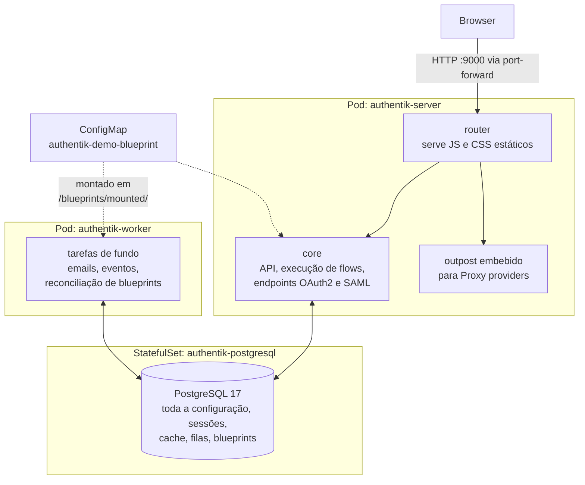
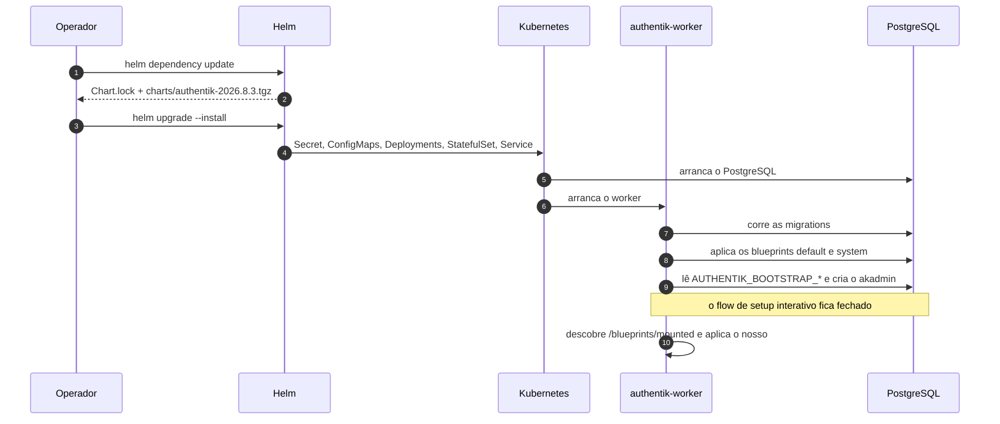
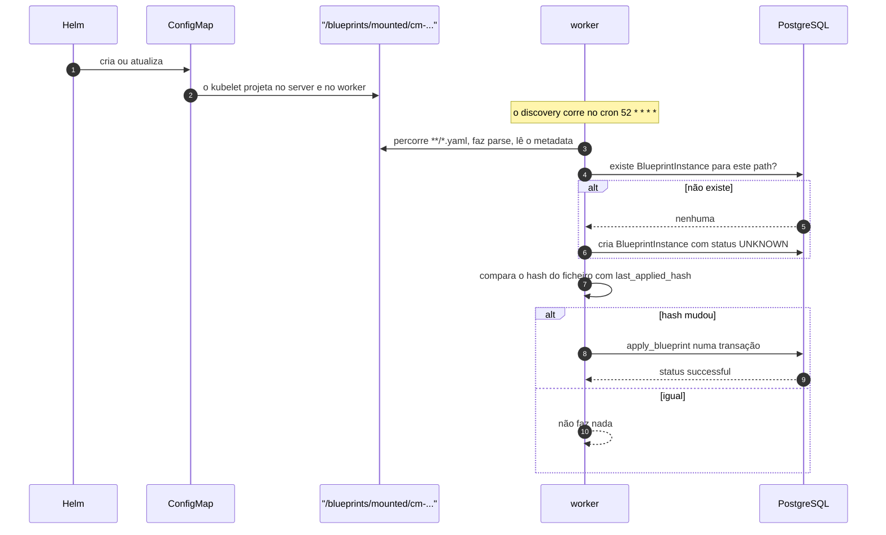
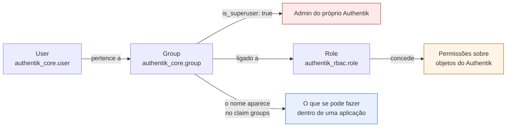
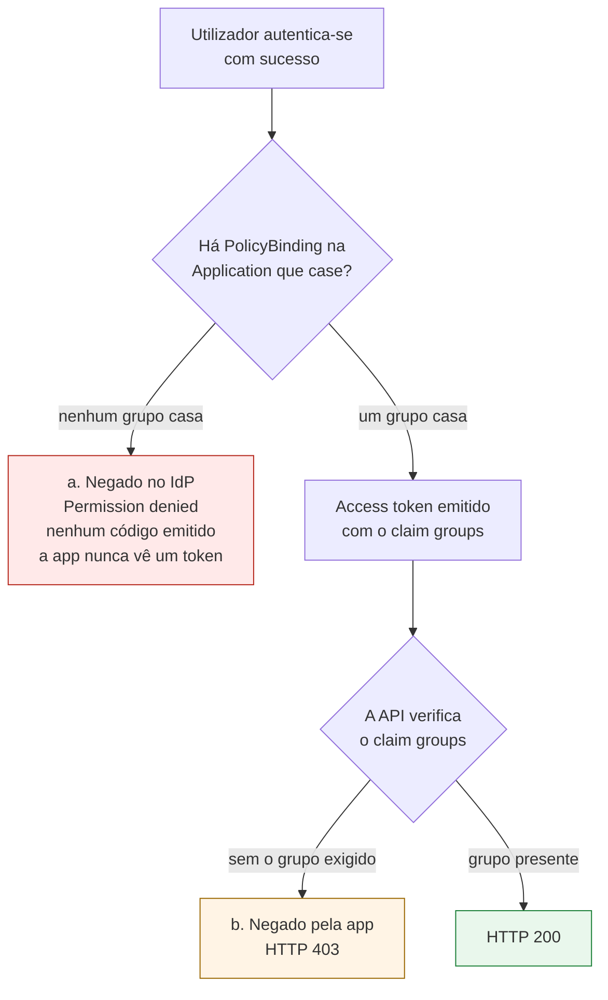
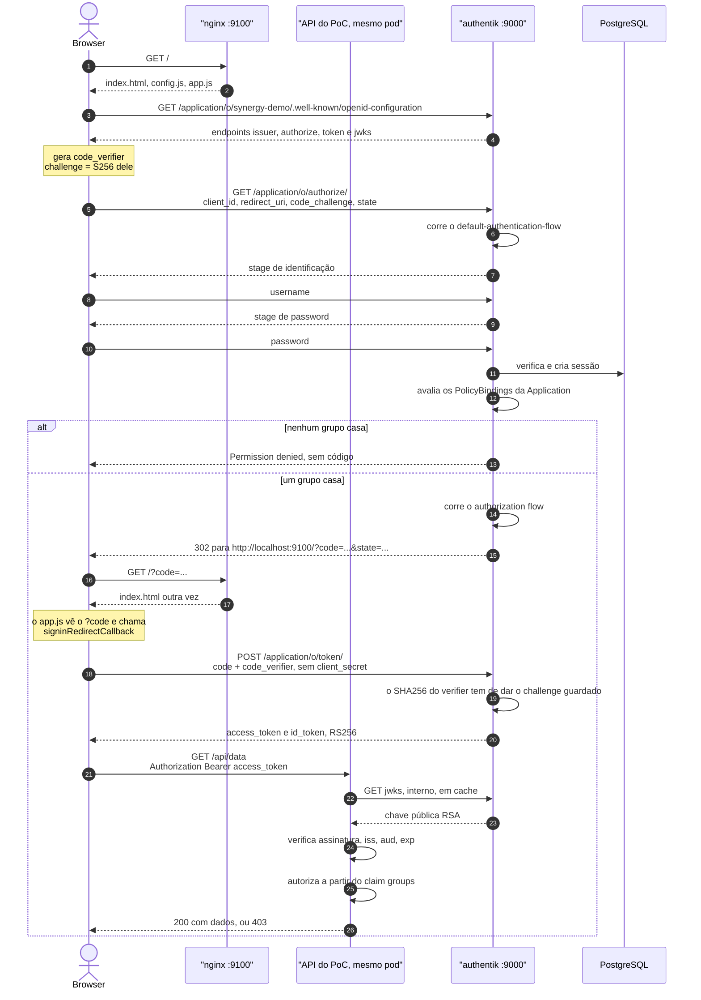
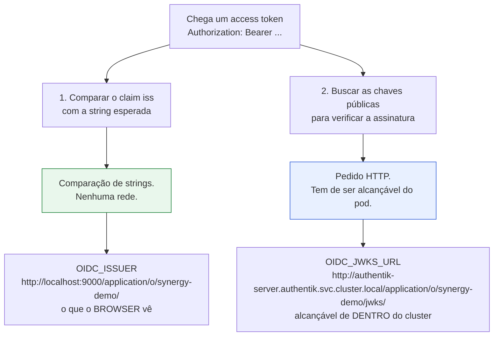
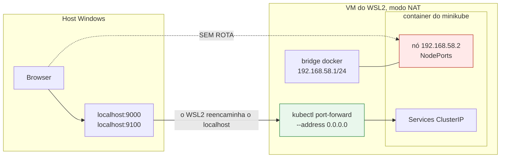
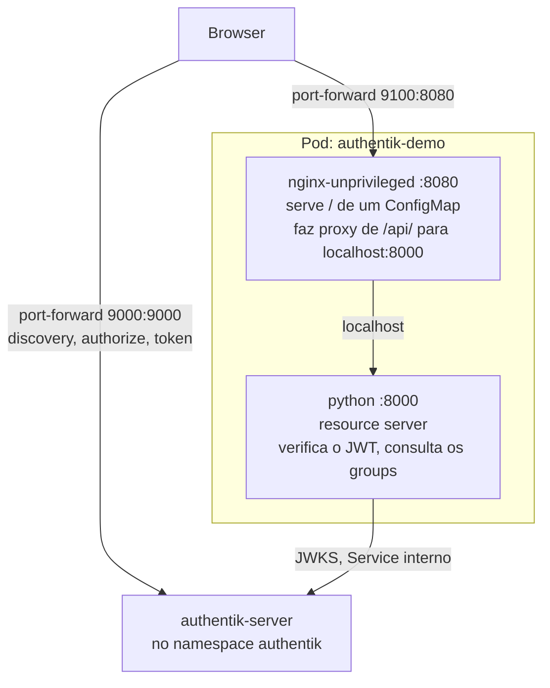
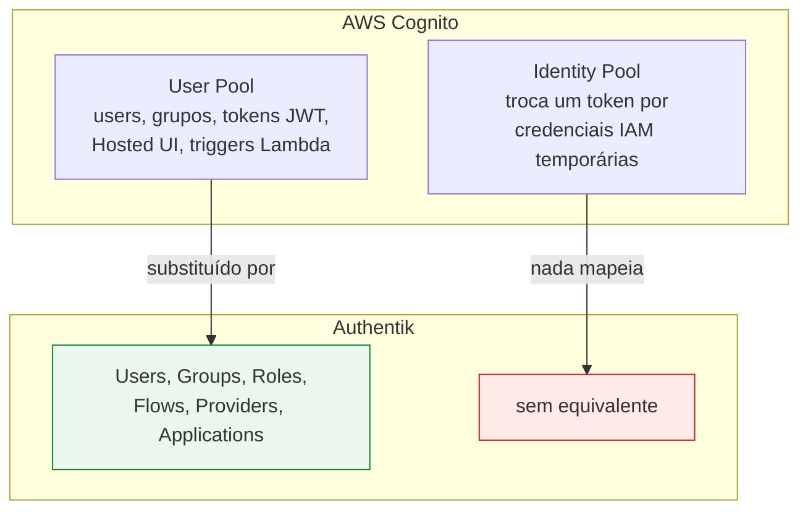

# Avaliação do Authentik

Documento de trabalho interno. Descreve o que está implementado no minikube, como cada peça
funciona e porque foi feita assim — do `helm install` até um token ser validado pela API da
app de demonstração.

Está escrito ao detalhe de propósito: o objetivo é que se perceba o caminho todo sem ter de
o reconstruir a partir dos templates.

> **Nota sobre a língua.** O `README.md:6` da raiz exige que toda a documentação do repo seja
> em inglês. Este ficheiro é uma exceção deliberada por ser material interno; terá de ser
> traduzido quando passar para a wiki oficial.

> **Estado.** Avaliação, não produção. Todas as credenciais nos `values.yaml` são
> `devonly-changeme`, comitadas de propósito, exatamente como faz
> `core/k8ssandra/values.yaml`. Nada disto está ligado ao Argo CD.

## Índice

1. [O que está implementado](#1-o-que-está-implementado)
2. [Arquitetura](#2-arquitetura)
3. [Organização no repo](#3-organização-no-repo)
4. [Deploy: do Helm ao Authentik a correr](#4-deploy-do-helm-ao-authentik-a-correr)
5. [Blueprints: configuração como código](#5-blueprints-configuração-como-código)
6. [Modelo de identidades](#6-modelo-de-identidades)
7. [Fluxos de autenticação e autorização](#7-fluxos-de-autenticação-e-autorização)
8. [`oidc.issuer` vs `oidc.jwksUrl`](#8-oidcissuer-vs-oidcjwksurl)
9. [Acesso: porque localhost e port-forward](#9-acesso-porque-localhost-e-port-forward)
10. [A SPA e a API](#10-a-spa-e-a-api)
11. [Cognito: o que mapeia e o que não](#11-cognito-o-que-mapeia-e-o-que-não)
12. [Usar as interfaces](#12-usar-as-interfaces)
13. [Troubleshooting](#13-troubleshooting)
14. [O que falta](#14-o-que-falta)

---

## 1. O que está implementado

| Release | Namespace | Chart | Conteúdo |
|---|---|---|---|
| `authentik` | `authentik` | `authentik-0.1.0` (envolve `authentik` 2026.8.3) | server, worker, PostgreSQL |
| `authentik-demo` | `authentik-demo` | `authentik-demo-0.1.0` | a app de demonstração (SPA + API) |

Imagens efetivamente a correr:

```
authentik       server      ghcr.io/goauthentik/server:2026.8.3
authentik       worker      ghcr.io/goauthentik/server:2026.8.3
authentik       postgresql  docker.io/library/postgres:17.11-bookworm
authentik-demo  spa         docker.io/nginxinc/nginx-unprivileged:1.29-alpine
authentik-demo  api         docker.io/library/python:3.13-slim
```

Recursos pedidos, e um PVC de 8 Gi na StorageClass `standard` do minikube:

| Container | requests | limits |
|---|---|---|
| server | 200m / 512Mi | 1Gi memória |
| worker | 200m / 512Mi | 2Gi memória |
| postgresql | 100m / 256Mi | 1Gi memória |
| spa | 10m / 32Mi | 128Mi memória |
| api | 50m / 64Mi | 256Mi memória |

Não há limites de CPU em nenhum sítio, seguindo `core/janus-graph/values.yaml`.

### O que não está deployado, de propósito

- **Argo CD.** Foi instalado durante a avaliação e removido quando o âmbito passou para
  autenticação aplicacional.
- **Envoy Gateway, ClusterIssuer para este host, External Secrets.** São assuntos de SKE.
  Localmente não há ingress nenhum — o acesso é por `kubectl port-forward` (§9).
- **Redis.** Não é esquecimento, ver §2.

---

## 2. Arquitetura



Três processos, uma base de dados. O **server** trata de tudo o que é síncrono: chamadas à
API, execução de flows, os endpoints OAuth2 e SAML. O **worker** trata do assíncrono — e isso
interessa-nos porque **a reconciliação de blueprints é uma tarefa do worker**.

### O Redis já não existe

O Authentik removeu o Redis por completo na versão **2025.10**. Cache, fila de tarefas
(Dramatiq), sessões do outpost embebido e WebSockets passaram todos para PostgreSQL. O chart
tem exatamente uma dependência de dados.

Duas consequências práticas:

- Qualquer tutorial ou chart anterior a 2025.10 que mande instalar Redis está desatualizado.
- O Authentik passou a usar cerca de 50% mais ligações a PostgreSQL, e é por isso que o chart
  traz `max_connections = 500` na `extendedConfiguration` do subchart.

### O subchart de PostgreSQL, e a armadilha que traz

`postgresql.enabled: true` traz o chart de PostgreSQL da Bitnami **18.8.17**, que vem
empacotado dentro do próprio `.tgz` do Authentik — não se vai buscar nada a um registry OCI
no momento do render. O upstream depois substitui a imagem por `docker.io/library/postgres`,
a oficial, porque a Bitnami restringiu o seu registry em 2025.

O chart da Bitnami recusa uma imagem que não seja dela a não ser que lhe digam que pode, e
essa flag **tem de ficar na raiz** do `values.yaml`:

```yaml
# management/authentik/values.yaml
global:
  security:
    allowInsecureImages: true
```

Não pode ficar debaixo da chave `authentik:`. O Helm só propaga o mapa `global` **da raiz**
pela árvore de charts, e o PostgreSQL está dois níveis abaixo (`authentik` → `postgresql`).
Posto noutro sítio, renderiza bem e falha em runtime.

---

## 3. Organização no repo

```
management/authentik/              # o identity provider
├── Chart.yaml                     dependência: authentik 2026.8.3 de https://charts.goauthentik.io
├── Chart.lock                     fixa a versão
├── config.yaml                    appName / sourcePath / destinationNamespace
├── values.yaml                    perfil local
└── templates/
    └── demo-blueprint-configmap.yaml

evaluation/authentik-demo/         # a app de demonstração
├── Chart.yaml                     sem dependências, manifestos próprios
├── values.yaml
└── templates/
    ├── _helpers.tpl
    ├── configmap-spa.yaml         index.html, app.js, config.js
    ├── configmap-api.yaml         api.py
    ├── configmap-nginx.yaml       serve / e faz proxy de /api/
    ├── deployment.yaml            2 containers
    ├── service.yaml
    └── serviceaccount.yaml
```

O Authentik está em `management/` porque segue a convenção de wrapper charts do repo, ao lado
do `argocd` e do `harbor`: tooling de plataforma com UI própria, hostname e password de admin.

A app de demonstração está em `evaluation/`, um diretório de topo novo. **Nenhuma
ApplicationSet faz glob a esta pasta e não há `config.yaml`**, logo nada aqui é reconciliado
pelo Argo CD nem deployado em SKE por acidente. Segue o precedente do `migration/`, que está
deliberadamente fora do GitOps pela mesma razão: é trabalho pontual, não estado desejado.

### Duas coisas que o chart do Authentik não tem, de propósito

- **Não tem `_helpers.tpl`.** Os nomes de templates do Helm são globais no release, e este
  wrapper tem o mesmo nome do chart upstream. Um `define "authentik.labels"` aqui sobrepunha-se
  em silêncio ao do subchart. As labels estão escritas inline no único template que precisa.
- **Não tem nenhum template chamado `secret*.yaml`.** O `.gitignore` do repo tem o glob
  `secret*.yaml` sem âncora, logo um ficheiro assim seria ignorado pelo git sem aviso nenhum.
  A convenção da casa é o sufixo `<coisa>-secret.yaml`.

### Onde os values vivem

Os values do upstream ficam sob a chave com o nome da dependência, `authentik:`. Os nossos
ficam no topo: `demoApp:`. Uma esquisitice a esperar quando se lê o `values.yaml` — o chart
upstream tem o **seu próprio** bloco `authentik:` de configuração, logo a `secret_key` do
Authentik está em `authentik.authentik.secret_key`. Desconfortável, mas é o que a convenção
produz.

---

## 4. Deploy: do Helm ao Authentik a correr

### Bootstrap: saltar o setup interativo

Normalmente o Authentik obriga a completar um flow interativo em `/if/flow/initial-setup/`
para escolher a primeira password de admin. Isso não é reproduzível, por isso o chart define
duas variáveis de ambiente no **worker**:

```yaml
worker:
  env:
    - name: AUTHENTIK_BOOTSTRAP_EMAIL
      value: "akadmin@synergy.local"
    - name: AUTHENTIK_BOOTSTRAP_PASSWORD
      value: "devonly-changeme"
```

São lidas **apenas no primeiro arranque contra uma base de dados vazia**. Mudá-las depois não
faz nada; tem de se fazer reset da password na UI. A partir daí o flow de setup fica fechado —
devolve `ak-stage-access-denied`, que é o comportamento esperado e correto, não uma falha.

### Sequência de deploy



### Procedimento

```bash
cd /home/tanastacio/Kubernetes_Testing/test-repo/synergy-local

# 1. Resolver o chart upstream. Escreve o Chart.lock e charts/*.tgz (gitignored).
helm dependency update management/authentik

# 2. Render seco antes de tocar no cluster.
helm template authentik management/authentik -n authentik > /dev/null

# 3. Instalar. Leva alguns minutos: o PostgreSQL tem de subir antes das migrations.
helm upgrade --install authentik management/authentik \
  -n authentik --create-namespace --wait --timeout 8m

# 4. Três pods Running.
kubectl -n authentik get pods

# 5. A app de demonstração.
helm upgrade --install authentik-demo evaluation/authentik-demo \
  -n authentik-demo --create-namespace --wait --timeout 6m
```

### Como a configuração chega aos containers

Tudo o que está no bloco `authentik:` de configuração é achatado pelo chart em variáveis de
ambiente `AUTHENTIK_<CHAVE>__<SUBCHAVE>`, codificado em base64 dentro de **um único Secret**
com o nome do release, e montado com `envFrom`. Logo `authentik.postgresql.password` torna-se
`AUTHENTIK_POSTGRESQL__PASSWORD`. Os valores passam por `tpl`, e é por isso que
`host: "{{ .Release.Name }}-postgresql"` funciona.

Para ver o que os pods vão realmente receber:

```bash
kubectl -n authentik get secret authentik -o json \
  | python3 -c "import sys,json,base64; d=json.load(sys.stdin)['data']; [print(f'{k} = {base64.b64decode(v).decode()}') for k,v in sorted(d.items())]"
```

Atenção a um interruptor de tudo-ou-nada: definir `authentik.existingSecret.secretName` faz
com que o chart **não renderize Secret nenhum**, e passa a ser preciso fornecer todas as
chaves `AUTHENTIK_*` à mão.

---

## 5. Blueprints: configuração como código

Os blueprints são a forma de a configuração do próprio Authentik passar a viver em git. Sem
eles, cada grupo, provider e flow existe só no PostgreSQL, criado a clicar.

O modelo mental é o `kubectl apply` para objetos do Authentik:

| Kubernetes | blueprint do Authentik |
|---|---|
| manifesto YAML | blueprint YAML |
| `kind: Deployment` | `model: authentik_core.group` |
| `metadata.name` identifica | `identifiers:` identifica |
| `spec:` é o estado desejado | `attrs:` é o estado desejado |
| um controller reconcilia | o **worker** reconcilia |

### Anatomia

```yaml
version: 1                       # versão do formato, sempre 1
metadata:
  name: synergy-demo             # o nome do blueprint na UI do Authentik
entries:
  - model: authentik_core.group  # que tipo de objeto, em <app_django>.<modelo>
    id: group-synergy-admins     # alcunha local, só para referências dentro deste ficheiro
    identifiers:                 # como ENCONTRAR o objeto
      name: "synergy-admins"
    attrs:                       # como ele deve FICAR
      is_superuser: false
```

A distinção entre `identifiers` e `attrs` é o que torna isto idempotente:

- O Authentik procura um objeto que case com os `identifiers`.
- **Não encontra** → cria, com `identifiers` + `attrs`.
- **Encontra** → atualiza, aplicando os `attrs`.

Correr um blueprint dez vezes dá o mesmo resultado que correr uma. Mudar um `identifier`
**não renomeia** o objeto — cria um segundo.

### As duas tags YAML próprias

Isto é sintaxe do Authentik, não é YAML:

**`!Find [modelo, [campo, valor]]`** — referencia um objeto que já existe e que este blueprint
não criou. É o equivalente literal a escolher uma opção num dropdown da UI:

```yaml
authorization_flow: !Find [authentik_flows.flow, [slug, default-provider-authorization-implicit-consent]]
```

**`!KeyOf <id>`** — referencia outra entrada **deste mesmo** ficheiro, pelo seu `id`:

```yaml
provider: !KeyOf provider-demo
```

Esta é necessária, não decorativa: a Application precisa do UUID do Provider, e esse UUID só
existe depois de o Provider ser criado. A ordem de avaliação **entre** blueprints diferentes
não é garantida, por isso dependências entre objetos têm de viver no mesmo ficheiro e usar
`!KeyOf`.

Cada blueprint é aplicado numa **transação atómica única** — ou os nossos seis objetos existem
todos, ou nenhum existe.

### Ciclo de vida, e a parte que faz perder tempo



**O discovery corre no cron `52 * * * *` — minuto 52 de cada hora.** Uma alteração ao
blueprint pode portanto ficar até uma hora sem efeito nenhum, o que se parece exatamente com
uma falha. Para forçar:

```bash
kubectl -n authentik exec deploy/authentik-worker -- ak shell -c \
  "from authentik.tasks.schedules.models import Schedule; \
   Schedule.objects.get(actor_name='authentik.blueprints.v1.tasks.blueprints_discovery').send()"
```

A reconciliação só reaplica se o hash do ficheiro mudou, por isso correr isto é seguro e
barato.

Para confirmar o resultado:

```bash
kubectl -n authentik exec deploy/authentik-worker -- ak shell -c \
  "from authentik.blueprints.models import BlueprintInstance; \
   print(list(BlueprintInstance.objects.filter(path__startswith='mounted').values_list('path','status')))"
# [('mounted/cm-authentik-demo-blueprint/demo.yaml', 'successful')]
```

### Como o ConfigMap é montado

```yaml
# management/authentik/values.yaml
authentik:
  blueprints:
    configMaps:
      - authentik-demo-blueprint
```

O chart monta cada ConfigMap indicado em `/blueprints/mounted/cm-<nome>/` **no server e no
worker**, e só as chaves acabadas em `.yaml` são descobertas. O ConfigMap em si é renderizado
por `templates/demo-blueprint-configmap.yaml`, logo o nome aparece em dois sítios e tem de
bater certo.

### O que o nosso blueprint cria

Seis entradas:

| # | Modelo | Objeto |
|---|---|---|
| 1 | `authentik_core.group` | `synergy-admins` |
| 2 | `authentik_core.group` | `synergy-readonly` |
| 3 | `authentik_providers_oauth2.oauth2provider` | `synergy-demo`, cliente público |
| 4 | `authentik_core.application` | slug `synergy-demo` |
| 5 | `authentik_policies.policybinding` | `synergy-admins` → a Application |
| 6 | `authentik_policies.policybinding` | `synergy-readonly` → a Application |

**Os utilizadores não estão no blueprint.** São criados pela UI, para o fluxo de gestão ser
exercitado e documentado — ver §6.

### Duas armadilhas que este blueprint já pagou

**O `grant_types` tem default de lista vazia.** A UI pré-seleciona os grants habituais; um
blueprint não. Lista vazia não permite nada, e o `/application/o/authorize/` responde:

```
error=invalid_request&error_description=The%20request%20is%20otherwise%20malformed
```

com `Invalid grant_type for provider` no log do servidor — uma mensagem que o cliente nunca
vê. Custou uma hora. O chart agora define-o explicitamente:

```yaml
demoApp:
  grantTypes:
    - authorization_code
```

**A `signing_key` não é opcional num cliente público.** Sem chave de assinatura o Authentik
assina os tokens em **HS256 usando o client secret**, e um cliente público não tem secret
utilizável — logo a API nunca conseguiria verificar nada. Com chave, os tokens são **RS256**
e verificáveis pelo endpoint JWKS. O blueprint fixa o certificado auto-assinado do próprio
Authentik:

```yaml
signing_key: !Find [authentik_crypto.certificatekeypair, [name, "authentik Self-signed Certificate"]]
```

---

## 6. Modelo de identidades

### Users, groups e roles são três coisas diferentes



### Não existe utilizador superuser

Verificado diretamente na instância a correr:

```
Group.is_superuser  ->  BooleanField      (coluna real, guardada)
User.is_superuser   ->  cached_property   (derivado, nunca guardado)

akadmin.is_superuser = True
grupos do akadmin    = [('authentik Admins', True)]
```

O `akadmin` é admin **porque pertence a um grupo que o é**. Tira-se do grupo e deixa de ser.
É uma decisão de desenho: no Authentik as permissões passam sempre por grupos, e não há forma
de dar uma a um indivíduo.

É por isso que `is_superuser: false` aparece nos nossos dois grupos no blueprint. É um campo
do modelo e algo tem de ser dito sobre ele, e dizê-lo explicitamente documenta que o assunto
foi considerado. `is_superuser` tornaria os membros administradores **do Authentik**, o que
não tem nada a ver com ser admin *dentro* de uma aplicação.

### As três camadas de autorização

| Camada | Controla | Onde se configura | Usada por nós |
|---|---|---|---|
| **1. Pertença a grupo** | quem pertence a quê | Authentik, por blueprint | sim |
| **2. RBAC do Authentik** — `Role`, `is_superuser` | permissões sobre **o próprio Authentik** | Authentik | não |
| **3. Autorização da aplicação** | o que se pode fazer **dentro da app** | a própria aplicação | sim, na API do PoC |

A camada 3 é a que surpreende. **O Authentik nunca sabe o que "admin" significa na tua
aplicação.** Só afirma pertença a grupo; quem consome é que decide quanto vale essa pertença.
É autorização federada normal, e é exatamente a forma do claim `cognito:groups` do Cognito
mais um mapeamento do lado da aplicação.

Os três níveis que o PoC distingue não são portanto Roles do Authentik — são nomes de grupos
que a API interpreta:

| Grupo | O que a API do PoC permite |
|---|---|
| `synergy-admins` | leitura e escrita |
| `synergy-readonly` | só leitura |
| nenhum | nada; recusado antes de ser emitido um token |

A camada 2 existe e já vem com objetos de origem — `authentik Read-only` e
`authentik Agent-Users` são Roles reais numa instalação nova — mas nada nesta avaliação
precisa de uma. Uma Role seria a ferramenta certa para, por exemplo, um grupo de helpdesk que
pudesse fazer reset de passwords no Authentik sem ser administrador total.

### Dois sítios onde o acesso pode ser negado



**(a)** é o controlo mais forte e é imposto pelas duas entradas de `PolicyBinding`. O
`policy_engine_mode` da Application é `any` — verificado, é o default do modelo — logo os
bindings são alternativas: pertencer a **qualquer** dos grupos dá acesso. Com `all`, o
utilizador teria de estar nos dois.

Verificado: o `akadmin`, que não pertence a nenhum dos grupos, autentica-se e é depois
recusado em `/application/o/authorize/` com uma página HTML intitulada `Permission denied`.
Não é emitido código de autorização nenhum.

**(b)** é a verificação dentro da aplicação, e é o que a API do PoC faz. As duas são
necessárias: (a) mantém fora quem não é utilizador, (b) distingue admin de readonly entre
quem entrou.

### Criar utilizadores e grupos na UI

Os grupos já existem — o blueprint criou-os. Só os utilizadores e a associação são manuais.

1. **Criar o utilizador** — *Directory → Users → Create*. Username, Name, Email. Não há campo
   de password aqui.
2. **Definir a password** — abrir o utilizador, menu de ações → *Set password*.
3. **Associar ao grupo** — *Directory → Groups → `synergy-admins` → separador Users →
   Add existing user*.

Vale a pena fazer o passo 3 à mão uma vez para ver o ponto: **não se escolhe permissão
nenhuma**, só pertença. É a totalidade daquilo que o Authentik afirma sobre uma pessoa.

Os dois utilizadores que os critérios de aceitação pedem:

| Username | Name | Email | Grupo |
|---|---|---|---|
| `synergy.admin` | Synergy Admin | admin@synergy.local | `synergy-admins` |
| `synergy.viewer` | Synergy Viewer | viewer@synergy.local | `synergy-readonly` |

Um terceiro utilizador sem grupo é dispensável — o `akadmin` já demonstra esse caminho.

### Alterações de grupo só valem no próximo login

A pertença a grupo é avaliada **durante a autenticação** e fica gravada no token. Retirar
alguém de um grupo não revoga um access token já emitido; mantém o nível até expirar ou até
fazer login de novo. Convém dizer isto em qualquer revisão de segurança a sério.

---

## 7. Fluxos de autenticação e autorização

### Vocabulário do Authentik

| Termo | O que é |
|---|---|
| **Flow** | sequência ordenada de Stages. Substitui a Hosted UI do Cognito, e é totalmente editável |
| **Stage** | um passo: identificação, password, TOTP, consentimento, user_write, … |
| **Policy** | um portão sim/não. Pode ligar-se a um flow, a um stage dentro do flow, ou a uma Application |
| **Provider** | a implementação do protocolo: OAuth2/OIDC, SAML, LDAP, Proxy, RADIUS, SCIM |
| **Application** | a casca visível ao utilizador — nome, ícone, URL de lançamento, e **quem pode usar** |
| **Property mapping** | expressão Python que produz claims para um scope |
| **Brand** | defaults por domínio, incluindo que flows usar quando o provider não indica nenhum |
| **Source** | federação de entrada, isto é, fazer login *com* a Google ou um IdP SAML |
| **Outpost** | componente deployado à parte, para providers Proxy, LDAP ou RADIUS |

### Provider vs Application, e porque são separados

Esta separação confunde todos à primeira:

| | Provider | Application |
|---|---|---|
| É | a maquinaria do protocolo | a casca visível |
| Guarda | client_id/secret, redirect URIs, chave de assinatura, scopes | nome, ícone, launch URL, **política de acesso** |
| Quem vê | ninguém, é invisível | aparece no portal do utilizador em `/if/user/` |

Três razões que justificam o objeto extra:

1. **O controlo de acesso vive na Application**, não no Provider. O `PolicyBinding` aponta a
   uma Application.
2. O **`slug` da Application define o issuer OIDC**: `<authentik-url>/application/o/<slug>/`.
   Mudar o slug parte todos os clientes.
3. Pode trocar-se o Provider — de OIDC para SAML — sem os utilizadores notarem.

O Cognito não tem equivalente: os App Clients não têm casca visível. É um conceito próprio
do Authentik.

### Flows que vêm de origem

Uma instância nova tem quinze, todos criados pelos blueprints do próprio Authentik:

```
default-authentication-flow                          default-provider-authorization-implicit-consent
default-invalidation-flow                            default-provider-authorization-explicit-consent
default-password-change                              default-provider-invalidation-flow
default-source-authentication                        default-source-enrollment
default-source-pre-authentication                    default-user-settings-flow
default-authenticator-totp-setup                     default-authenticator-static-setup
default-authenticator-webauthn-setup                 default-request
initial-setup
```

O PoC usa o `default-authentication-flow` para o login e o
`default-provider-authorization-implicit-consent` para a autorização. Implícito em vez de
explícito: o ecrã de consentimento acrescenta um clique por utilizador sem ensinar nada que o
flow de login já não mostre. Basta mudar `demoApp.authorizationFlow` para a variante
explícita para ver um stage de consentimento.

### A sequência completa de login

Authorization Code com **PKCE**, cliente público. O documento de discovery confirma
`code_challenge_methods_supported: ["plain", "S256"]` e
`id_token_signing_alg_values_supported: ["RS256"]`.



O passo do PKCE que interessa é o **21**: o endpoint de token recalcula
`SHA256(code_verifier)` e exige que seja igual ao `code_challenge` enviado no passo 7. Um
atacante que intercete o código de autorização não o consegue trocar sem o verifier, que nunca
saiu do browser. É isso que substitui o client secret que um browser não consegue guardar.

### Logout, e os dois flows de invalidação

O `app.js` chama `signoutRedirect()`, que envia o browser para o `end_session_endpoint` do
Authentik. O que acontece a partir daí depende de **qual flow de invalidação o provider usa**, e
os dois candidatos têm nomes parecidos e comportamentos diferentes:

| | `default-invalidation-flow` | `default-provider-invalidation-flow` |
|---|---|---|
| Corre quando | o logout **começa no Authentik**, por exemplo o botão de sair em `/if/user/` | o logout **começa numa aplicação** (OIDC, SAML, Proxy, RAC) |
| Tem o stage `user_logout` | **sim** | **não** |
| Efeito | termina a sessão do Authentik e dispara Single Logout nas apps ligadas | termina só a sessão *daquela* aplicação; a sessão do Authentik sobrevive |

O `default-provider-invalidation-flow` é o default para logout iniciado na aplicação, e a
ausência do stage é deliberada: em SSO, sair de uma app não deve obrigatoriamente expulsar o
utilizador do IdP e de todas as outras. **Mas num PoC cujo objetivo é demonstrar autenticação é o
comportamento errado**, e produz um sintoma que parece um bug no browser:

1. `Sign out` → corre o flow do provider → a sessão da aplicação desaparece.
2. `Sign in` → `/application/o/authorize/` vê uma **sessão do Authentik ainda válida**.
3. Com `default-provider-authorization-implicit-consent` não há sequer ecrã de consentimento,
   logo volta imediatamente um código. **Zero credenciais pedidas.**

Limpar os cookies não resolve, e é por uma razão que custa tempo a perceber: o cookie
`authentik_session` está na origem do **Authentik** —
`authentik-server.authentik.svc.cluster.local:9000` — e não em `localhost:9100`. Limpar os
cookies com a página da app em primeiro plano limpa só a origem da app. Uma janela privada também
não resolve: todas as tabs privadas partilham a mesma sessão, logo login → signout → login dentro
da mesma janela dá o mesmo resultado.

Por isso o `demoApp.invalidationFlow` aponta ao **`default-invalidation-flow`**, que é o flow
stock que traz o stage. Verificado na instância a correr:

```
INVALIDATION FLOW : default-invalidation-flow
STAGES            : [(0, 'default-invalidation-logout', 'UserLogoutStage')]
```

A alternativa, se não se quiser depender de um objeto stock, é o blueprint criar um
`userlogoutstage` próprio mais um flow de `designation: invalidation` que o use. Não foi feito
porque a troca de uma linha resolve o mesmo, mas é a forma mais correta e está em §14.

O browser volta depois ao URI de logout registado. É por isso que o blueprint registra o **mesmo
URL duas vezes**, com tipos diferentes:

```yaml
redirect_uris:
  - matching_mode: strict
    redirect_uri_type: authorization
    url: "http://localhost:9100/"
  - matching_mode: strict
    redirect_uri_type: logout
    url: "http://localhost:9100/"
```

O `redirect_uri_type` é um campo de 2026.5+; versões anteriores tratam todas as entradas como
URIs de autorização. O `matching_mode` é `strict` ou `regex`; strict é comparação exata.

### Porque os redirect URIs têm de ser pré-registados

Não é burocracia. Sem a allowlist, um atacante forjava
`&redirect_uri=http://evil.example/` e o Authentik entregava-lhe o código de autorização da
sessão da vítima. É o mesmo campo que as *Allowed callback URLs* do Cognito.

### O que vai no token, e de onde vem o `groups`

**Não existe um scope `groups` no Authentik.** Os nove scope mappings de origem são `openid`,
`profile`, `email`, `offline_access`, `entitlements`, `bound_key`, `ak_proxy`,
`goauthentik.io/api` e `goauthentik.io/oidc/dcr`.

O claim `groups` é emitido pelo mapping **`profile`**. Lido da instância a correr:

```python
return delete_none_values({
    "name": request.user.name,
    "given_name": ak_obj_attr(request.user, "given_name", "name"),
    "family_name": ak_obj_attr(request.user, "family_name"),
    "preferred_username": request.user.username,
    "nickname": request.user.username,
    "groups": [group.name for group in request.user.groups.all()],
    "picture": avatar if avatar and not avatar.startswith("data:") else None,
})
```

Pedir o scope `profile` é portanto o que torna a autorização por role possível, e **não é
preciso property mapping nenhum à medida**. Retirar o `profile` de `demoApp.scopes` faz todos
os utilizadores perderem a role em silêncio — as chamadas passam simplesmente a devolver 403
sem indicação de porquê.

Repara que o claim leva **nomes** de grupo. Renomear um grupo no Authentik parte todos os
consumidores que mapeiam nele, sem erro em sítio nenhum.

---

## 8. `oidc.issuer` vs `oidc.jwksUrl`

Este é o detalhe de configuração mais importante do PoC, e não é óbvio.

A API faz **duas coisas separadas** com o issuer:



Tratar isto como uma configuração só é o erro que leva a acreditar que o OIDC não funciona
atrás de um port-forward. Funciona: só a busca do JWKS precisa de ser encaminhável.

**O Authentik constrói o issuer a partir do header `Host`.** Verificado:

```bash
$ curl -s -H "Host: localhost:9000" \
    http://192.168.58.2:30080/application/o/synergy-demo/.well-known/openid-configuration
issuer: http://localhost:9000/application/o/synergy-demo/
```

Duas consequências:

- Cada hostname pelo qual se consiga chegar ao Authentik produz um **`iss` diferente**. Um
  token emitido por um hostname é rejeitado por um resource server que espere outro. **É por
  isso que os dois Services são `ClusterIP` com um único ponto de entrada por port-forward**,
  em vez de também expor um NodePort — duas portas significariam dois issuers.
- Em SKE, onde há um hostname real, o `jwksUrl` pode simplesmente apontar ao issuer público e
  a separação deixa de ser necessária. Continua configurável porque DNS split-horizon também
  é comum em produção.

A API reporta as duas, o que torna uma discrepância óbvia:

```bash
$ curl -s http://localhost:9100/api/health
{
  "status": "ok",
  "issuer_expected": "http://localhost:9000/application/o/synergy-demo/",
  "jwks_url": "http://authentik-server.authentik.svc.cluster.local/application/o/synergy-demo/jwks/",
  "verify_audience": true
}
```

O `aud` do access token é o client ID, e a API verifica-o. O `OIDC_VERIFY_AUDIENCE` existe só
para diagnosticar um `InvalidAudienceError`.

---

## 9. Acesso: porque localhost e port-forward

A abordagem local óbvia — NodePort mais DNS wildcard `nip.io` — foi a primeira tentativa e
**não funciona de um browser no Windows**. A razão:



O `192.168.58.2` está em `br-7c2470da51cf`, uma bridge docker **dentro da VM do WSL2**. Com o
WSL no modo NAT por omissão — sem `networkingMode=mirrored` no `.wslconfig` — o Windows não
tem rota para lá. O `curl` de dentro do WSL funciona, e um pedido de dentro de um pod também,
e foi isso que fez a abordagem original parecer verificada. **O browser é um terceiro ponto de
vista, e é o único que conta.**

O `kubectl port-forward` contorna isto por completo, porque o WSL2 reencaminha o `localhost`
do Windows para dentro da VM. Funciona também sem alterações de dentro do WSL e de um desktop
Linux.

```bash
kubectl port-forward --address 0.0.0.0 -n authentik      svc/authentik-server 9000:9000 &
kubectl port-forward --address 0.0.0.0 -n authentik-demo svc/authentik-demo   9100:8080 &
```

O `9000` não é arbitrário: é a porta de container do próprio Authentik, o que faz os URLs da
documentação oficial baterem certo com o que se tem à frente. O `9100` também não: é o que
está registado como redirect URI, e `matching_mode: strict` exige igualdade ao caráter.

Os port-forwards morrem com o terminal e quando um pod é substituído. Se uma página deixar de
carregar, reinicia-os antes de investigar qualquer outra coisa.

O `k9s` também faz port-forward, e é cómodo — mas o túnel morre com o `k9s`. Antes de uma demo
convém arrancar os dois à mão num terminal que não se toca, em vez de depender de uma ferramenta
interativa que se fecha por reflexo. Para ver quem está mesmo a servir uma porta:

```bash
ss -ltnp | grep -E '9000|9100'
```

---

## 10. A SPA e a API

### O que o PoC prova, e o que não prova

| Afirmação | Como |
|---|---|
| Uma app de browser autentica-se contra o Authentik sem client secret | Authorization Code + PKCE, `client_type: public` |
| O token leva os grupos do utilizador | claim `groups` do scope `profile`, mostrado na UI |
| A autorização pode ser imposta do lado do servidor | a API verifica o JWT contra o JWKS e consulta os `groups` |
| Esconder UI não é controlo de acesso | os botões são desativados por role, mas a API recusa de qualquer forma — testa com `curl` |
| Quem não é membro nunca recebe token | o `PolicyBinding` recusa antes de ser emitido um código |

**Não prova** nada sobre escala, tempo de vida de sessão, refresh tokens (o scope
`offline_access` não é pedido, logo não existem) ou proteção contra CSRF.

### Forma



Dois containers, um pod, um Service, **uma origem**.

Uma origem é o ponto. O nginx serve a SPA em `/` e faz proxy de `/api/` para a API por
localhost dentro do pod. Mesma origem significa **zero CORS** — sem preflight, sem headers
`Access-Control-*` para errar — e é mais parecido com a forma como as páginas reais são
servidas do que dois hostnames diferentes seriam.

### A SPA

HTML e JavaScript simples com [`oidc-client-ts`](https://github.com/authts/oidc-client-ts)
por CDN. Sem build, sem npm, sem node. A lógica de tokens porta-se diretamente para React
quando as páginas reais forem migradas; só a renderização muda.

```js
var mgr = new oidc.UserManager({
  authority: cfg.issuer,
  client_id: cfg.clientId,
  redirect_uri: origin,              // de volta a "/" — uma página, sem rota de callback
  post_logout_redirect_uri: origin,
  response_type: "code",             // o PKCE é aplicado automaticamente para "code"
  scope: cfg.scopes,
  userStore: new oidc.WebStorageStateStore({ store: window.localStorage }),
  automaticSilentRenew: false
});
```

Três decisões que vale a pena notar:

- **O `redirect_uri` é a própria página.** Ao carregar, o `app.js` procura `?code=` no URL,
  chama `signinRedirectCallback()` e depois limpa a query com `history.replaceState`, para que
  um refresh não tente reutilizar um código já gasto.
- **`localStorage`, não `sessionStorage`.** A sessão sobrevive a um refresh, o que torna a
  demo menos irritante. O `sessionStorage` é marginalmente mais seguro e fica por aba; uma app
  a sério deve pesar isso, e um backend-for-frontend a guardar tokens em cookies `HttpOnly` é
  mais seguro ainda.
- **Sem silent renew.** O `offline_access` não é pedido, logo não há refresh token e a sessão
  acaba simplesmente quando o access token expira.

A UI desativa `/api/data` para quem não tem role e `/api/admin` para quem não é admin. Isso é
apresentação, não proteção, e a própria página diz isso.

### A API

O `api.py` é a peça que espelha o que hoje fazem o API Gateway mais um Lambda authorizer
contra o Cognito. **Nada nele é específico do Authentik** — é OIDC puro, e a única coisa que
muda ao sair do Cognito é o URL do issuer. É o achado mais útil da avaliação.

```python
ISSUER   = os.environ["OIDC_ISSUER"].rstrip("/") + "/"   # comparado, nunca buscado
JWKS_URL = os.environ["OIDC_JWKS_URL"]                   # buscado, tem de ser alcançável
JWKS     = PyJWKClient(JWKS_URL)

claims = jwt.decode(
    token, key,
    algorithms=["RS256"],          # fixo; confiar no header do próprio token
                                   # é como se fazem ataques de confusão de algoritmo
    issuer=ISSUER,
    audience=AUDIENCE,
    options={"require": ["exp", "iat", "iss"]},
)
```

O `PyJWKClient` guarda as chaves em cache e vai buscá-las outra vez quando aparece um `kid`
desconhecido, logo uma rotação de chaves no Authentik não obriga a reiniciar nada.

**A autorização vive aqui e não no browser.** A SPA esconde botões que o utilizador não pode
usar, o que é uma cortesia e não um controlo: qualquer pessoa chama estes endpoints com
`curl`. Só este ficheiro decide.

### Endpoints

| Endpoint | Exige | Sem token | Token sem grupo que case |
|---|---|---|---|
| `GET /api/health` | nada — a readiness probe usa-o | 200 | 200 |
| `GET /api/me` | token válido | 401 | 200, devolve os claims |
| `GET /api/data` | `synergy-admins` ou `synergy-readonly` | 401 | **403** |
| `POST /api/admin` | `synergy-admins` | 401 | **403** |

Uma resposta 403 diz o que era exigido e o que o token realmente tinha, o que torna o modelo
de roles legível sem ler o código:

```json
{
  "error": "forbidden",
  "detail": "none of the required groups are present on the token",
  "required_any_of": ["synergy-admins"],
  "groups_on_token": ["synergy-readonly"]
}
```

### Compromissos assumidos

**Nenhum dos dois containers usa imagem construída.** O código é montado de ConfigMaps, e a
API corre `pip install PyJWT[crypto]` no arranque. Custa uns 20 segundos de startup e exige
saída de rede do pod. É uma troca deliberada para uma avaliação num cluster sem pipeline de
build e sem registry — o Harbor está declarado em `management/harbor` mas não está instalado
localmente. **É a primeira coisa a mudar se isto for para ficar.**

A startup probe está dimensionada para o install, não para o arranque do processo:
`initialDelaySeconds: 10`, `failureThreshold: 24`.

A **postura de segurança** segue `core/janus-graph/templates/deployment.yaml`: `runAsNonRoot`,
`seccompProfile: RuntimeDefault`, `allowPrivilegeEscalation: false`,
`capabilities.drop: [ALL]`, `readOnlyRootFilesystem: true` com um `emptyDir` e `sizeLimit`
para cada caminho escrevível, `automountServiceAccountToken: false` na ServiceAccount e no
pod, e `requests` de CPU e memória com limite só de memória.

O nginx corre como uid 101 a partir do `nginx-unprivileged` e escuta em 8080, logo o
`runAsNonRoot` não obriga a remendar a imagem.

### Estado da verificação

| Caminho | Verificado |
|---|---|
| SPA e assets servidos | sim — 200 em `index.html`, `config.js`, `app.js` |
| `/api/health` sem autenticação | sim — 200, a reportar o issuer esperado e o JWKS interno |
| Todos os endpoints protegidos sem token | sim — 401 |
| Token malformado | sim — 401 com `DecodeError` |
| Não-membro negado no IdP | sim — o `akadmin` autentica-se e leva `Permission denied` no authorize, sem código emitido |
| Admin: 200 em `/api/data` e `/api/admin` | a confirmar no dry run — o utilizador `synergy.admin` já existe |
| Readonly: 200 em `/api/data`, 403 em `/api/admin` | a confirmar no dry run — o utilizador `synergy.viewer` já existe |
| Logout termina a sessão do Authentik | configuração verificada: o provider usa o `default-invalidation-flow` e esse flow traz o `UserLogoutStage`. O round-trip no browser confirma-se no dry run |

Os dois utilizadores de §6 estão criados e nos grupos; são feitos à mão na UI de propósito. As
três últimas linhas fecham-se com o dry run de [DEMO.md](DEMO.md), que percorre exactamente estes
caminhos.

### Teste rápido sem browser

```bash
# A API está de pé e reporta a configuração separada
curl -s http://localhost:9100/api/health

# Tudo o que é protegido recusa um chamador anónimo
for p in /api/me /api/data; do
  printf "%-12s %s\n" "$p" "$(curl -s -o /dev/null -w '%{http_code}' http://localhost:9100$p)"
done
curl -s -o /dev/null -w "POST /api/admin %{http_code}\n" -X POST http://localhost:9100/api/admin

# Um token malformado é rejeitado com uma razão legível
curl -s -H "Authorization: Bearer nonsense" http://localhost:9100/api/me
```

Esperado: `401`, `401`, `401`, e
`{"error": "unauthenticated", "detail": "DecodeError: Not enough segments"}`.

---

## 11. Cognito: o que mapeia e o que não

### O Cognito são dois produtos, e só um tem equivalente



**User Pool → Authentik** é uma substituição limpa. **Identity Pool → nada.** O Authentik não
emite credenciais STS da AWS e não tem sequer o conceito.

Se as páginas a migrar chamam serviços AWS diretamente do browser, ou batem no API Gateway com
autorização IAM, então substituir o Cognito não é trocar o IdP — esse caminho de autorização
tem de ser redesenhado.

**A resposta provável, e é boa:** os Identity Pools do Cognito aceitam **qualquer** OIDC
provider como identity provider. Logo substitui-se só o User Pool pelo Authentik e mantém-se o
Identity Pool a federar para o Authentik, continuando a emitir credenciais AWS. Vai-se metade
da dependência do Cognito; a metade que não tem equivalente fica e continua a funcionar.

> **Pergunta aberta que bloqueia uma recomendação final.** Se as duas páginas precisam ou não
> de credenciais de Identity Pool não se sabe sem o código. É a decisão com mais peso na
> migração.

### Mapeamento de conceitos

| Cognito | Authentik | Notas |
|---|---|---|
| User Pool | a instância, mais **Brand** | não há multi-pool; isola-se por Brand e policies |
| User | **User** `authentik_core.user` | `attributes` livres, ≈ custom attributes |
| Group | **Group** `authentik_core.group` | aninhável por `parent`; `is_superuser` = admin do Authentik |
| Group usado para permissões da app | nome do Group no claim `groups` | mesmo padrão federado |
| Role IAM assumida via grupo | **Role** `authentik_rbac.role` | mas só sobre objetos do Authentik, não AWS |
| App Client | **Provider** | um por protocolo |
| — | **Application** | sem equivalente no Cognito; leva a política de acesso e o slug |
| Hosted UI | **Flow** de **Stages** | totalmente editável, ao contrário da Hosted UI |
| Trigger Lambda: pre-token-generation | expressão de **Property mapping** | Python |
| Trigger Lambda: pre-sign-up, post-confirmation | **Expression Policy** no flow de enrolment | Python |
| Lambda **authorizer** a validar tokens | validação de JWT contra **JWKS** | mudança de configuração, não de arquitetura — é o que a API do PoC prova |
| claim `cognito:groups` | claim `groups` do scope `profile` | existe de origem |
| Scopes e claims personalizados | **Property mappings** (Scope Mapping) | |
| MFA | **Stages**: TOTP, WebAuthn, SMS, Duo | compostos num flow |
| IdP federado | **Source** | |
| **Identity Pool** | **nada** | ver acima |
| Autenticação SRP | não suportada | o Authentik usa OIDC e SAML padrão |
| APIs de admin do Cognito (CLI, SDK) | REST API mais **blueprints** | os blueprints são melhores para GitOps |

### Limitações encontradas

| # | Limitação | Impacto | Mitigação |
|---|---|---|---|
| 1 | Não emite credenciais AWS | O que depender de Identity Pools deixa de funcionar | Manter o Identity Pool a federar para o Authentik |
| 2 | Sem multi-tenancy comparável a vários User Pools | Uma instância é um diretório | Brands mais policies, ou instâncias separadas |
| 3 | A autorização não é centralizada | Cada aplicação tem de implementar o mapeamento a partir de `groups` | Igual ao Cognito; a API do PoC mostra o padrão |
| 4 | O claim `groups` leva nomes, não IDs estáveis | Renomear um grupo parte consumidores em silêncio | Tratar nomes de grupo como API, ou mapping próprio que emita UUIDs |
| 5 | Alterações de grupo só valem no próximo login | A revogação não é imediata | Tempos de vida de token curtos |
| 6 | Campos de blueprint com defaults diferentes da UI | `grant_types: []` não permite nada, com erro enganador | Definir sempre grants e signing key explicitamente |
| 7 | Discovery de blueprints em cron horário | Alterações parecem não fazer nada durante até uma hora | Disparar o discovery, §5 |
| 8 | Issuer derivado do header `Host` | Vários hostnames produzem vários issuers | Um único ponto de entrada por ambiente |
| 9 | `existingSecret` é tudo-ou-nada | Não se injeta só um valor | Fornecer todas as chaves `AUTHENTIK_*`, ou usar `global.env` com `secretKeyRef` |
| 10 | É self-hosted, logo é nosso para operar | Backups do Postgres, upgrades e disponibilidade passam a ser nosso problema | Ver §14 |

Onde o Authentik é **melhor** que o Cognito, para equilibrar: os flows são totalmente
editáveis em vez de uma Hosted UI fixa; a configuração é declarativa e versionada por
blueprints; providers LDAP, RADIUS, SCIM e Proxy vêm incluídos; e não há custo por utilizador
ativo.

---

## 12. Usar as interfaces

Com os dois port-forwards de §9 a correr:

| | URL | Credenciais |
|---|---|---|
| Admin do Authentik | http://localhost:9000/if/admin/ | `akadmin` / `devonly-changeme` |
| Portal do utilizador | http://localhost:9000/if/user/ | o mesmo |
| App de demonstração | http://localhost:9100/ | um utilizador num dos dois grupos |

### O que ver no admin

- *Directory → Users* e *Groups* — os `synergy-admins` e `synergy-readonly` criados pelo
  blueprint, e os três grupos que vêm de origem.
- *Applications → Applications → Synergy Demo* — a casca. No separador de policies estão os
  dois `PolicyBinding`.
- *Applications → Providers → synergy-demo* — o Provider. Repara em `client_type: public`, na
  ausência de secret, nos `grant_types` e nos redirect URIs.
- *Flows and Stages → Flows* — os quinze flows de origem. Abre o
  `default-authentication-flow` para ver os stages em sequência.
- *Customization → Property Mappings → Scope Mappings* — abre o `profile` e confirma a linha
  que emite o `groups`.
- *System → Tasks* — o estado das tarefas do worker, incluindo o `blueprints_discovery`.
- *Customization → Blueprints* — o nosso `synergy-demo` deve estar `successful`.

### O portal do utilizador

O `/if/user/` é o que um utilizador normal vê: as Applications a que tem acesso. Um
utilizador em `synergy-readonly` vê a Synergy Demo; o `akadmin` não a vê, porque nenhum
`PolicyBinding` casa com os seus grupos. É a camada (a) de §6 a funcionar visivelmente.

---

## 13. Troubleshooting

**`error=invalid_request&error_description=The request is otherwise malformed` no
`/application/o/authorize/`.** O `grant_types` do provider está vazio. Um blueprint não o
preenche como a UI faz. O log do servidor diz `Invalid grant_type for provider`, que o cliente
nunca vê. Define o `demoApp.grantTypes`.

**`redirect_uri_mismatch`.** O URL do browser não corresponde exatamente a nenhum redirect URI
registado. O `matching_mode: strict` compara caráter a caráter, incluindo a barra final e a
porta. `127.0.0.1` em vez de `localhost` também falha.

**A API devolve 401 com `InvalidIssuerError`.** O `iss` do token não é igual ao
`OIDC_ISSUER`. O Authentik deriva o issuer do header `Host`, logo isto normalmente significa
que se chegou ao Authentik por um hostname diferente daquele que a API espera. Compara
`curl http://localhost:9100/api/health` com o `iss` do token.

**A API devolve 401 com erro de JWKS ou de ligação.** O `OIDC_JWKS_URL` não é alcançável do
pod. Tem de ser o Service interno, não o URL que o browser usa.

**A API devolve 401 com `InvalidAudienceError`.** O `aud` não é o client ID. Põe
`oidc.verifyAudience: false` para confirmar que é essa a causa, e depois corrige o client ID
em vez de deixar a verificação desligada.

**Todos os utilizadores levam 403 da API apesar de estarem num grupo.** Falta o scope
`profile` em `demoApp.scopes`, logo o token não tem claim `groups`. Descodifica o access token
e confirma.

**`Permission denied` depois de um login com sucesso.** Está a funcionar como devido: nenhum
`PolicyBinding` da Application casa com os grupos do utilizador. Acrescenta-o ao
`synergy-admins` ou ao `synergy-readonly`, e lembra-te de que só vale no próximo login.

**Uma alteração ao blueprint não faz nada.** O discovery corre no `52 * * * *`. Dispara-o à
mão, §5.

**Um blueprint com status `failed`.** Lê o motivo na instância em vez de adivinhar:

```bash
kubectl -n authentik exec deploy/authentik-worker -- ak shell -c \
  "from authentik.blueprints.models import BlueprintInstance; \
   b=BlueprintInstance.objects.get(path__startswith='mounted'); print(b.status, b.metadata)"
```

**O browser não chega a `http://authentik.<ip>.nip.io:30080`.** Esperado no WSL2 em modo NAT:
esse endereço é uma bridge docker dentro da VM Linux. Usa os port-forwards de §9.

**O botão de login não faz nada e a consola mostra erro ao buscar o
`.well-known/openid-configuration`.** O port-forward do Authentik não está a correr. O browser
busca o discovery por si, logo o `localhost:9000` tem de estar de pé.

**Mudei a SPA ou a API e não aconteceu nada.** O Deployment tem anotações de checksum para os
três ConfigMaps, logo o `helm upgrade` recria o pod. Se não recriou, o port-forward está a
apontar ao pod antigo — reinicia-o.

**Uma página deixou de carregar sem razão.** Um port-forward morreu, o que acontece sempre que
o pod é substituído. Reinicia antes de investigar mais nada.

---

## 14. O que falta

### Para fechar o que está implementado

Os dois utilizadores de §6 estão criados e associados aos grupos. O logout está corrigido no
provider (§7). Os três caminhos que faltavam — 200 do admin, 403 do readonly e o logout no
browser — fecham-se com o dry run de [DEMO.md](DEMO.md); ver a tabela em §10.

### Itens da task ainda não feitos

- **Documentar a integração com o Argo CD.** O Argo CD foi instalado durante a avaliação e
  removido quando o âmbito mudou. O padrão está estudado — OIDC direto com `dex.enabled:
  false` contra Dex, mapeamento de grupos em `configs.rbac.policy.csv` — mas não está escrito
  nem validado com um login.
- **Plano de alto nível para deploy em STACKIT**, e as respetivas histórias. O essencial que
  muda: exposição por `HTTPRoute` no Envoy Gateway em vez de port-forward (o chart do
  Authentik renderiza um nativamente por `server.route.main`); hostname real e TLS do
  `letsencrypt-dns`; secrets por ExternalSecret do StackIT Secrets Manager em vez de
  plaintext; PostgreSQL gerido ou CloudNativePG em `premium-perf2-stackit` com backups;
  registo na ApplicationSet de `management`; réplicas e PDB; e SMTP, que é obrigatório para os
  flows de recuperação de password.
- **Demo à equipa.** O guião está escrito, em [DEMO.md](DEMO.md): 12 minutos, business primeiro
  e a parte técnica depois. Falta fazer o dry run cronometrado e apresentar.

Nota já apurada para a história de migração de identidades: **o Cognito não exporta hashes de
password.** Os utilizadores migrados têm de fazer reset, ou ser migrados de forma lazy por um
Lambda de user-migration que valide contra o Cognito uma vez e escreva no Authentik.

### Dívida conhecida

- Não há `values-ske.yaml` em nenhum dos dois charts.
- O flow de invalidação do provider é o `default-invalidation-flow`, um objeto **stock**. Resolve
  o logout numa linha (§7), mas a versão correta é o blueprint criar um `userlogoutstage` próprio
  mais um flow de `designation: invalidation` que o use, e apontar o provider a esse. Assim a
  configuração do logout deixa de depender de um objeto que não é nosso.
- O `authentik.blueprints.secrets` não é usado. Qualquer blueprint que precise de levar uma
  credencial real — o client secret do Argo CD, por exemplo — pertence a um Secret e não a um
  ConfigMap.
- Sem monitorização. O `server.metrics` e o `prometheus.rules` estão ambos desligados porque
  não há Prometheus neste cluster.
- A API do PoC instala dependências em runtime, ver §10.
- O IP `192.168.58.2` aparece hardcoded em comentários da documentação. Não afeta a
  configuração, que agora usa `localhost`, mas se o minikube for recriado com outro IP as
  referências ficam desatualizadas.
